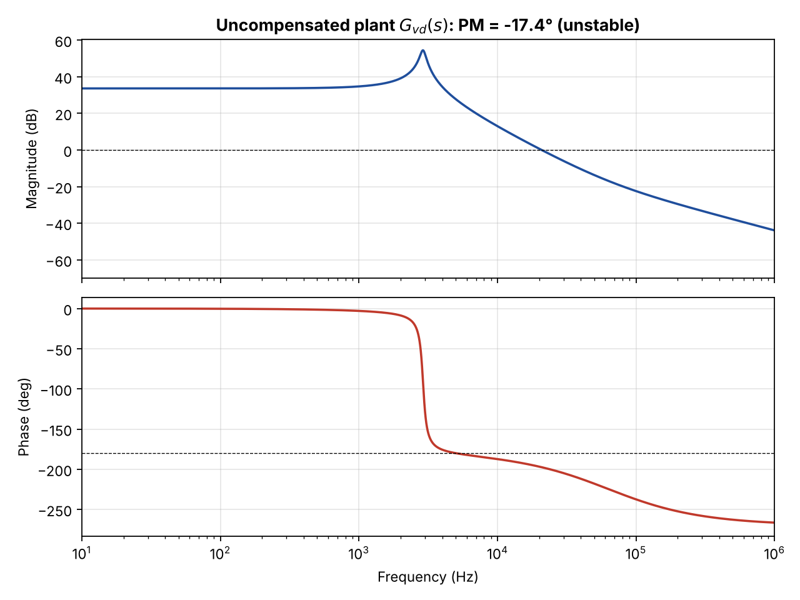
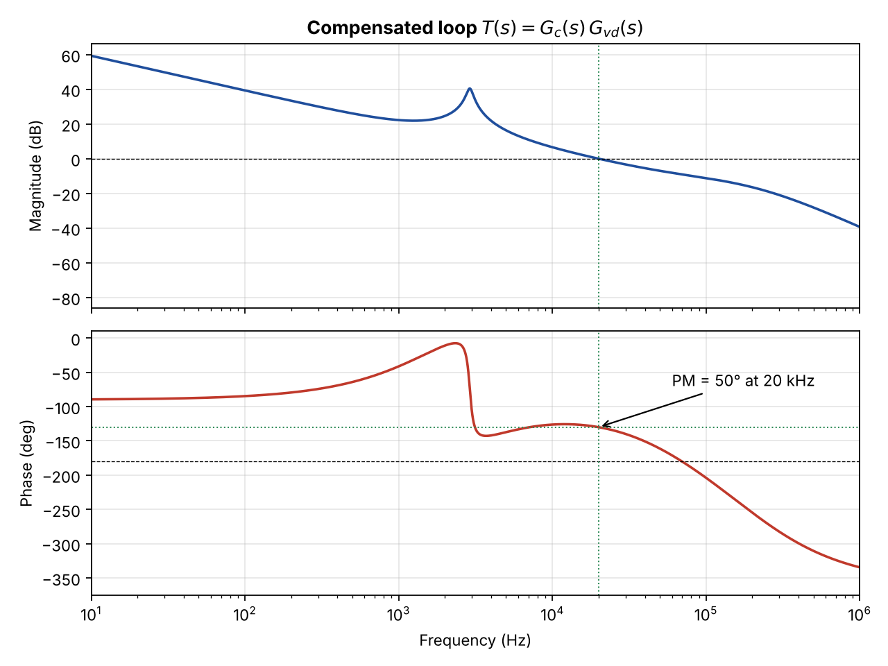
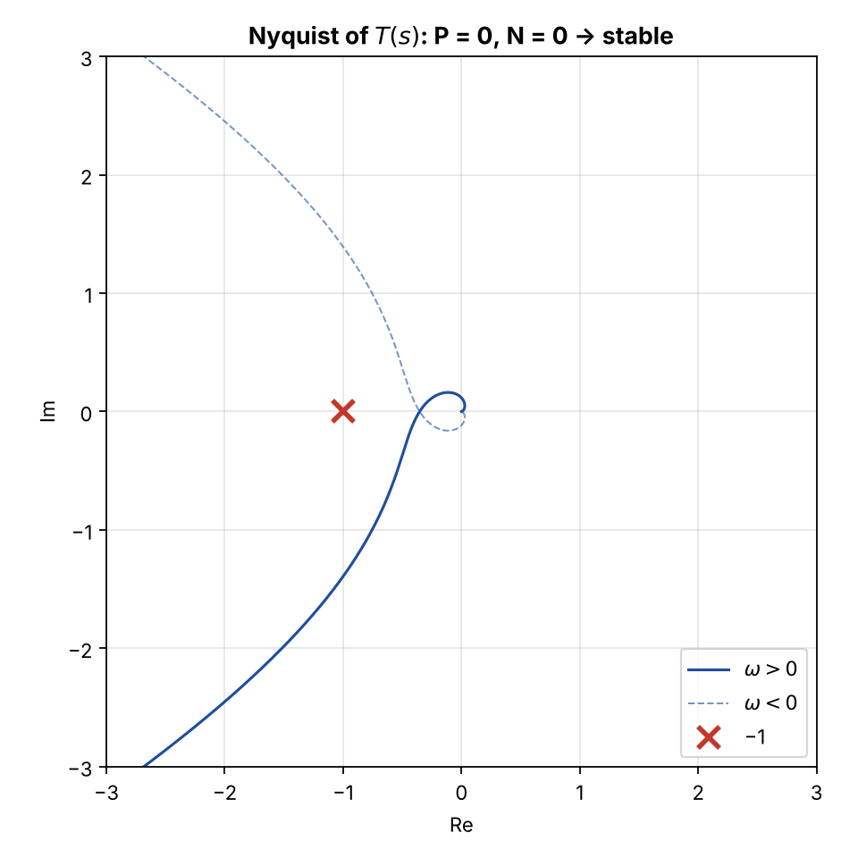
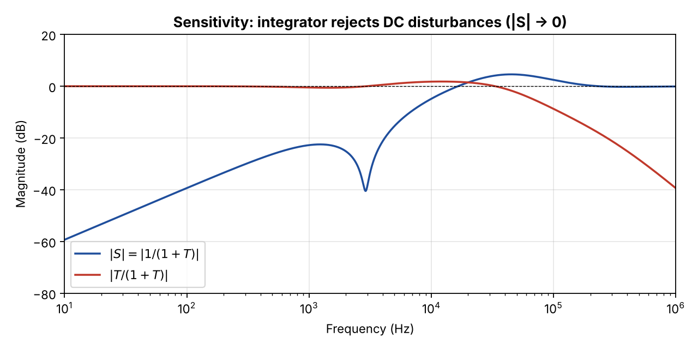
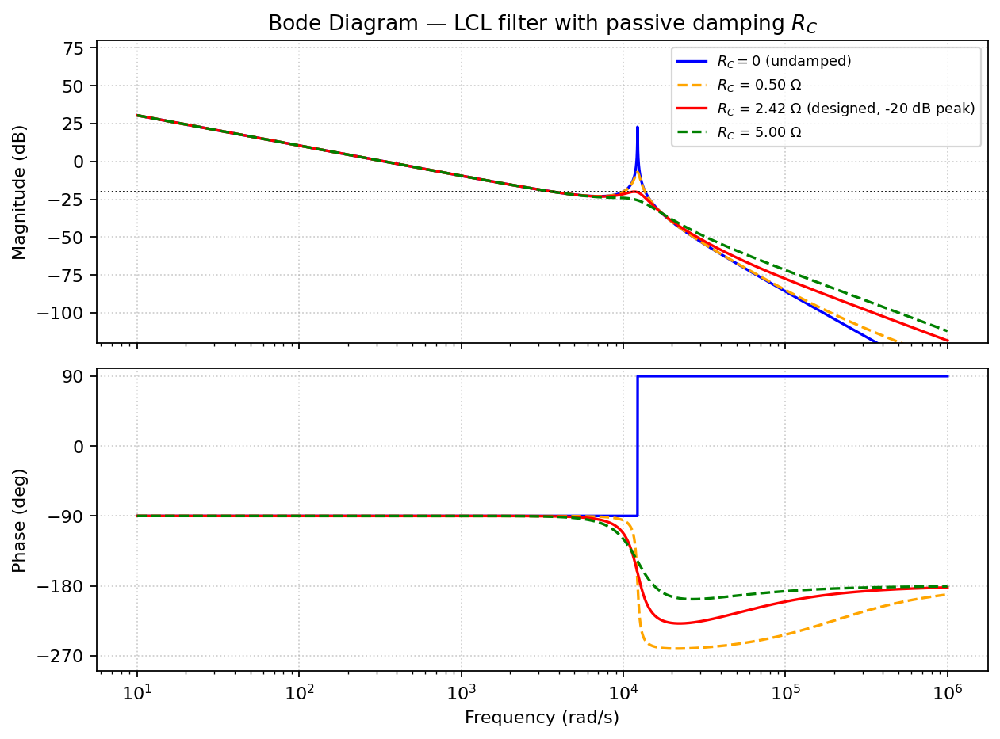
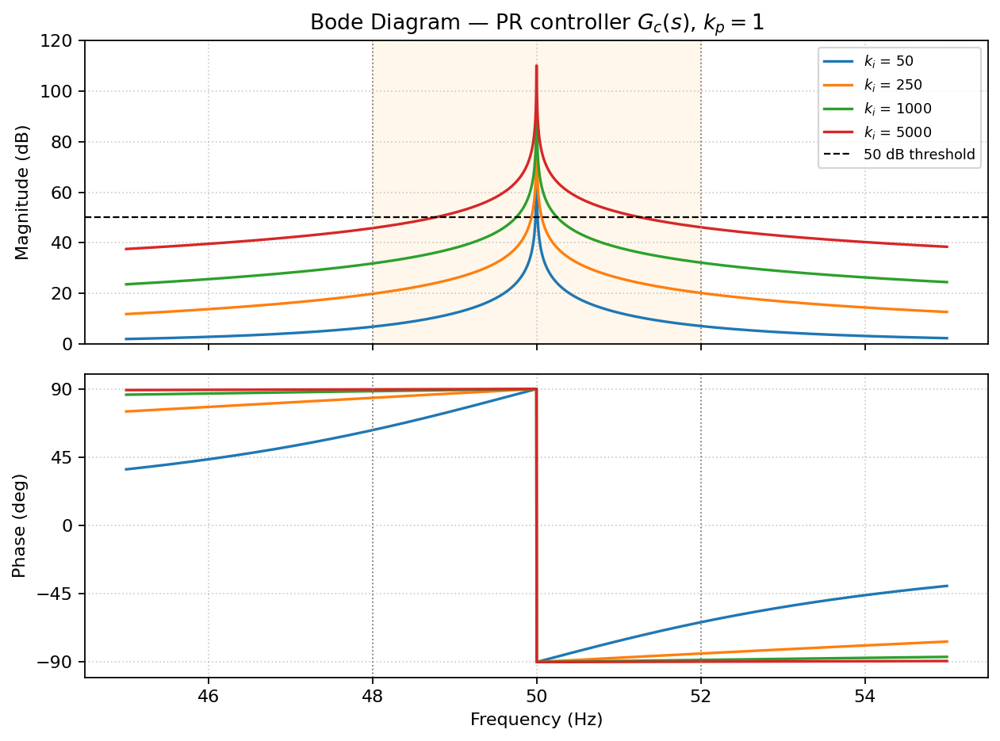

# Power Electronics Control Design: Flyback Type III & Grid Inverter PR Control

This repository has two loop-design studies in MATLAB and Python from the CAPE course (control of power electronic converters), MSc Electronic Engineering, UPC Barcelona, spring 2026:

1. **[Flyback converter, voltage-mode control](#1-flyback-48-v--12-v-type-iii-compensator).** The plant is unstable as given, and a **Type III compensator** brings it to **50° phase margin at a 20 kHz crossover**.
2. **[Grid-connected inverter with an LCL filter](#2-grid-connected-inverter-lcl-filter--pr-current-control).** The work covers passive resonance damping and a **proportional-resonant (PR)** grid-current controller.

These are the same building blocks I now use in my MSc thesis on the digital control of a SiC totem-pole PFC rectifier: averaged small-signal models, loop shaping, Nyquist and sensitivity checks, and resonant controllers for 50 Hz quantities.

---

## 1. Flyback 48 V → 12 V: Type III compensator

| V<sub>g</sub> | V | L<sub>m</sub> | C | n | R | Target |
|---|---|---|---|---|---|---|
| 48 V | 12 V | 240 µH | 50 µF | 1/4 | 12 Ω | f<sub>c</sub> = 20 kHz, PM = 50° |

**Plant.** The state-space averaged model, derived in [docs/flyback_state_space_modelling.pdf](docs/flyback_state_space_modelling.pdf), gives

$$G_{vd}(s)=\frac{\dfrac{V_g}{n}\left(1-\dfrac{L_m D n^2}{R(1-D)^2}\,s\right)}{L_m C\,s^2+\dfrac{L_m}{R}\,s+\dfrac{(1-D)^2}{n^2}}$$

with D = 0.5, a resonance at **2.9 kHz (Q ≈ 11)** and a **right-half-plane zero at 63.7 kHz**.

**Uncompensated loop.** PM = **−17.4°**, GM = **−27.6 dB**, so the closed loop is unstable. At 20 kHz the plant phase is already −196.7°, which means the compensator has to *add* **+66.7°** of phase. PI and Type II can't do that. Type III can.

**Design.** The compensator is

$$G_c(s)=\frac{G_{c0}}{s}\,\frac{(1+s/\omega_z)^2}{(1+s/\omega_p)^2}$$

The double zero and double pole are placed geometrically around f<sub>c</sub> (ω<sub>z</sub> = ω<sub>c</sub>/a, ω<sub>p</sub> = a·ω<sub>c</sub>, a ≈ 9.8). This gives **f<sub>z</sub> ≈ 2.04 kHz, f<sub>p</sub> ≈ 196 kHz** and **G<sub>c0</sub> ≈ 1209**, which sets |T(j2π·20 kHz)| = 1.

**Result:** f<sub>c</sub> = 20 kHz, **PM = 50°**. The Nyquist check gives P = 0 and N = 0, so the closed loop is stable. The integrator gives zero steady-state output error for a step in V<sub>g</sub>.

| Uncompensated | Compensated |
|---|---|
|  |  |
|  |  |

```bash
python flyback-type3/flyback_type3.py      # numpy, scipy, matplotlib -> prints the design values + figures
```

`flyback_control.m` is the MATLAB version as submitted, answering all six assignment questions with `tf`, `margin`, `nyquist` and `feedback`.

---

## 2. Grid-connected inverter: LCL filter + PR current control

Filter: L₁ = 2 mH, C = 10 µF, L₂ = 1 mH. The controlled variable is the grid current i₂, at a 50 Hz grid allowed to vary between 48 and 52 Hz.

| Step | Result |
|---|---|
| Undamped LCL plant, $I_2/V_i = 1/\left(s^3L_1L_2C + s(L_1+L_2)\right)$ | resonance at **1.95 kHz** with poles on the jω axis, so the peak is unbounded |
| Passive damping (R<sub>C</sub> in series with C), swept in MATLAB | **R<sub>C</sub> ≈ 2.42 Ω** keeps the peak at −20 dB |
| Why PR: $G_C(s)=k_p+\dfrac{k_i s}{s^2+\omega_g^2}$ | infinite gain at ω<sub>g</sub>, so zero steady-state error on the 50 Hz reference |
| k<sub>p</sub> = ω<sub>c</sub>(L₁+L₂) with ω<sub>c</sub> = ω<sub>res</sub>/10 | **k<sub>p</sub> ≈ 3.67**, crossover ≈ 197 Hz, PM ≈ 90° |
| k<sub>i</sub> for ≥ 50 dB controller gain over 48–52 Hz | 5000 is the best of the given options. It meets 50 dB from ≈48.8 to 51.3 Hz; covering the full band needs k<sub>i</sub> ≥ ≈8120 |

| LCL plant with passive damping | PR controller vs k<sub>i</sub> |
|---|---|
|  |  |

The full write-up is in [grid-inverter-pr-lcl/report.pdf](grid-inverter-pr-lcl/report.pdf), with the LaTeX source alongside. The script is `CAPE_DC_AC.m`.

---

## Repository layout

```
flyback-type3/          flyback_control.m (MATLAB), flyback_type3.py (Python + figures), figures/
grid-inverter-pr-lcl/   CAPE_DC_AC.m, report.tex / report.pdf, figures/
docs/                   flyback state-space averaged modelling (PDF)
```

Course deliveries by Shahan Antabian with Ayush Mohapatra, MSc Electronic Engineering, UPC Barcelona.
